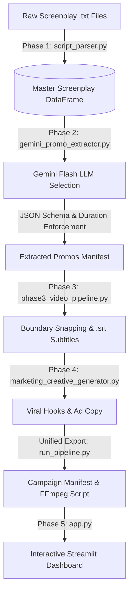

# 🎬 Kuku Microdrama Promotional Clip Extraction Pipeline

> An end-to-end, deterministic data engineering and GenAI pipeline that parses episodic microdrama screenplays, extracts viral promotional clips (strictly 20–60 seconds), aligns frame-accurate video slices with subtitles, and visualizes candidate clips in an interactive Streamlit dashboard.

---

## 📌 Executive Summary

Vertical microdrama platforms (such as ReelShort, ShortMax, DramaBox, and KuKu FM) rely heavily on short-form promotional clips (20 to 60 seconds) on TikTok, Instagram Reels, and YouTube Shorts for paid user acquisition. 

This repository automates the entire promotional clip extraction workflow:
1. **Deterministic Screenplay Ingestion**: Converts messy raw `.txt` screenplays into a structured Pandas DataFrame with millisecond timestamps and character emotion tags using robust regular expressions.
2. **AI-Driven Promo Selection**: Prompts Google Gemini with enforced JSON schemas to isolate the highest-converting dramatic excerpt based on strict video rules (Opening Hook, Ending Cliffhanger, Standalone Continuity, and Strict 20–60s Duration).
3. **Audio-Visual Alignment**: Snaps timestamps to line boundaries, generates synchronized SubRip (`.srt`) subtitle files, and builds lossless FFmpeg slicing scripts.
4. **Viral Creative Packaging**: Generates on-screen text overlays, social captions, hashtag taxonomies, and thumbnail timestamps.
5. **Interactive Stakeholder App**: A deployable Streamlit application (`app.py`) for marketing and editing teams to filter, rank, and download promotional manifests.

---

## 🏗️ Pipeline Architecture



---

## 📂 Repository Structure

```text
├── Data/                                    # Raw microdrama screenplay text files
│   └── I Married a Broken Soldier. He was a Duke/
├── output/                                  # Pipeline execution outputs
│   ├── master_parsed_screenplays.csv        # Phase 1: 3,727 parsed screenplay lines
│   ├── gemini_extracted_promos.csv          # Phase 2: Extracted clips from LLM
│   └── promo_campaign/
│       ├── promo_campaign_manifest.csv      # Unified campaign manifest
│       ├── slice_promos.bat                 # Lossless FFmpeg cutting commands
│       └── subtitles/                       # Synchronized .srt subtitle files
├── script_parser.py                         # Phase 1: Deterministic screenplay parser
├── clip_extractor.py                        # Combinatoric candidate window builder (20-60s)
├── gemini_promo_extractor.py                # Phase 2: Gemini API extractor with JSON schema
├── phase3_video_pipeline.py                 # Phase 3: Timestamp snapping & SRT generator
├── marketing_creative_generator.py          # Phase 4: Viral hooks, captions & thumbnails
├── run_pipeline.py                          # Unified orchestrator (Phases 1-4)
├── app.py                                   # Phase 5: Streamlit frontend web app
├── requirements.txt                         # Deployment dependencies
└── README.md                                # Comprehensive documentation
```

---

## 🚀 Quickstart Guide

### 1. Installation

Clone this repository and install the dependencies:
```bash
git clone https://github.com/your-username/kuku-promo-extractor.git
cd kuku-promo-extractor
pip install -r requirements.txt
```

### 2. Configure Your Gemini API Key

Set the `GEMINI_API_KEY` environment variable in your terminal:

- **Windows (PowerShell):**
  ```powershell
  $env:GEMINI_API_KEY="your_gemini_api_key"
  ```
- **Windows (Command Prompt):**
  ```cmd
  set GEMINI_API_KEY=your_gemini_api_key
  ```
- **macOS / Linux:**
  ```bash
  export GEMINI_API_KEY="your_gemini_api_key"
  ```

---

## ⚙️ Running the Pipeline

### Step 1: Parse Raw Scripts into Structured Data (Phase 1)
```bash
python batch_pipeline.py --input_dir "Data/I Married a Broken Soldier. He was a Duke" --output_dir "output"
```
*Outputs: `output/master_parsed_screenplays.csv` (3,727 lines across all 50 episodes with exact start/end seconds).*

### Step 2: Run End-to-End Promo Extraction & Subtitle Generation (Phases 2-4)
```bash
# Run on the first 5 episodes
python run_pipeline.py 5

# Run across all 50 episodes
python run_pipeline.py 50
```
*Outputs:*
- `output/promo_campaign/promo_campaign_manifest.csv`
- `output/promo_campaign/subtitles/*.srt`
- `output/promo_campaign/slice_promos.bat`

### Step 3: Launch the Interactive Streamlit Dashboard (Phase 5)
```bash
streamlit run app.py
```
Open [http://localhost:8501](http://localhost:8501) in your browser.

---

## 📊 Sample Output Manifest

| Episode | Start Time | End Time | Duration | On-Screen Hook | Social Caption |
|:---:|:---:|:---:|:---:|---|---|
| **Episode 1** | `00:39.00` | `01:00.00` | **`21.0s`** | *"She wore white. He chose her sister."* | Imagine standing at the altar only to find out your family gave your groom to your sister... Watch the revenge unfold! |
| **Episode 2** | `00:00.00` | `00:44.70` | **`44.7s`** | *"Too plain to marry? Think again."* | He called her unworthy in front of everyone. Watch her destroy his reputation with one speech! 🔥 |
| **Episode 3** | `01:19.30` | `02:04.20` | **`44.9s`** | *"A penniless soldier stepped forward."* | Cast aside by a lord, claimed by a soldier who hid a dangerous secret... ⚔️ |

---

## ☁️ Deployment on Streamlit Community Cloud

1. Push your codebase to a public or private GitHub repository.
2. Sign in to [Streamlit Community Cloud](https://share.streamlit.io/).
3. Click **"New app"**, select your repository, branch, and specify `app.py` as the entrypoint.
4. Under **"Advanced settings"**, add your secret:
   ```toml
   GEMINI_API_KEY = "your_actual_api_key_here"
   ```
5. Click **"Deploy!"**. Your dashboard will be live with an interactive URL.

