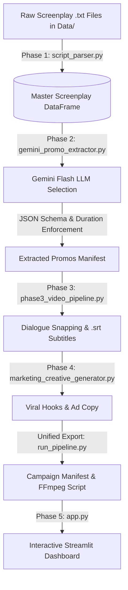

# 🎬 Kuku Microdrama Promotional Clip Extraction Pipeline

> An end-to-end, deterministic data engineering and GenAI pipeline that parses episodic microdrama screenplays, extracts viral promotional clips (strictly 20–60 seconds), aligns frame-accurate video slices with subtitles, and visualizes candidate clips in an interactive Streamlit dashboard.

---

## 📌 Executive Summary

Vertical microdrama platforms (such as ReelShort, ShortMax, DramaBox, and KuKu FM) rely heavily on short-form promotional clips (20 to 60 seconds) on TikTok, Instagram Reels, and YouTube Shorts for paid user acquisition. 

This repository automates the entire promotional clip extraction workflow:
1. **Deterministic Screenplay Ingestion**: Converts raw `.txt` screenplays into a structured Pandas DataFrame with millisecond timestamps and character emotion tags using robust regular expressions (3,727 lines across 50 episodes).
2. **AI-Driven Promo Selection**: Prompts Google Gemini with enforced JSON schemas to isolate the highest-converting dramatic excerpt based on strict video rules (Opening Hook, Ending Cliffhanger, Standalone Continuity, and Strict 20–60s Duration).
3. **Audio-Visual Alignment**: Snaps timestamps strictly to dialogue line starts, generates synchronized SubRip (`.srt`) subtitle files, and builds frame-accurate FFmpeg slicing scripts (re-encoding video with `libx264` and audio with `aac`).
4. **Viral Creative Packaging**: Generates on-screen text overlays, social captions, hashtag taxonomies, and thumbnail timestamps.
5. **Interactive Stakeholder App**: A deployable Streamlit application (`app.py`) for marketing and editing teams to filter, rank, and download promotional manifests.

---

## 🔒 Confidentiality Notice & Dataset Setup

The raw screenplay pack is confidential and is **not committed** to the Git repository (ignored via `.gitignore`).

To run the pipeline on local screenplay files:
1. Create a `Data/` directory in the repository root.
2. Place your raw `.txt` script files inside (e.g., `Data/I Married a Broken Soldier. He was a Duke/`).
3. Ensure `.env` and `secrets.toml` remain local and uncommitted.

---

## 🏗️ Pipeline Architecture



---

## 📂 Repository Structure

```text
├── Data/                                    # Raw screenplay pack (confidential, gitignored)
├── output/                                  # Pipeline execution outputs (gitignored)
│   ├── run_<YYYYMMDD_HHMMSS>/               # Isolated timestamped run artifacts
│   │   ├── promo_campaign_manifest.csv      # Run manifest with status & hooks
│   │   ├── slice_promos.bat                 # Frame-accurate FFmpeg cut commands
│   │   ├── failures.csv                     # Failures log (if any)
│   │   └── subtitles/                       # Synchronized .srt subtitle files
│   └── promo_campaign/                      # Shared manifest accessed by Streamlit
├── script_parser.py                         # Phase 1: Deterministic screenplay parser
├── clip_extractor.py                        # Combinatoric candidate window builder (20-60s)
├── gemini_promo_extractor.py                # Phase 2: Gemini API extractor with JSON schema
├── phase3_video_pipeline.py                 # Phase 3: Dialogue snapping & SRT generator
├── marketing_creative_generator.py          # Phase 4: Viral hooks, captions & thumbnails
├── run_pipeline.py                          # Unified orchestrator (Phases 1-4)
├── app.py                                   # Phase 5: Streamlit frontend web app
├── tests/
│   └── smoke_test.py                        # Automated test suite (plain asserts, no network)
├── requirements.txt                         # Deployment dependencies
├── push.bat                                 # Auto-push script (stages tracked code only)
└── README.md                                # Comprehensive documentation
```

---

## 🚀 Quickstart Guide

### 1. Installation

Clone this repository and install the dependencies:
```bash
git clone https://github.com/Sushank18/KuKu-FM.git
cd KuKu-FM
pip install -r requirements.txt
```

### 2. Configure Your Gemini API Key

Set the `GEMINI_API_KEY` environment variable in your terminal:

- **Windows (PowerShell):**
  ```powershell
  $env:GEMINI_API_KEY="your_gemini_api_key"
  ```
- **Windows (Command Prompt):**
  ```cmd
  set GEMINI_API_KEY=your_gemini_api_key
  ```
- **macOS / Linux:**
  ```bash
  export GEMINI_API_KEY="your_gemini_api_key"
  ```

*(Optional: Set `GEMINI_MODEL` to specify your preferred model, e.g. `gemini-3.5-flash-lite`, and `GEMINI_FALLBACK_MODELS` for comma-separated fallbacks).*

---

## ⚙️ Running the Pipeline

### Step 1: Run the Smoke Test Suite (Offline Verification)
```bash
python tests/smoke_test.py
```
*Validates that all 50 episodes parse into exactly 3,727 rows in numeric order, asserts subtitle millisecond carry-over rounding, and verifies that snapping never starts on continuation fragments (`...`).*

### Step 2: Run End-to-End Promo Extraction & Subtitle Generation (Phases 1-4)
```bash
# Run on all episodes by default
python run_pipeline.py

# Or run on a specific range or count
python run_pipeline.py --episodes 1-5
python run_pipeline.py --episodes 10
```
Each run generates an isolated directory `output/run_<YYYYMMDD_HHMMSS>/` containing:
- `promo_campaign_manifest.csv`: Status (`valid` or `needs_review`), timestamps, durations, and ad copy.
- `subtitles/*.srt`: Re-indexed subtitles starting at `00:00:00,000`.
- `slice_promos.bat`: Frame-accurate FFmpeg slicing script.
- `failures.csv`: Log of any failed episodes and reasons.

### Step 3: Launch the Interactive Streamlit Dashboard (Phase 5)
```bash
streamlit run app.py
```
Open [http://localhost:8501](http://localhost:8501) in your browser.

---

## 📊 Sample Output Manifest (Generated from Real Run)

Below are the actual promotional clips extracted from the 50-episode pack (*"I Married a Broken Soldier. He was a Duke"*):

| Episode | Start Time | End Time | Duration | Status | On-Screen Hook | Social Caption |
|:---:|:---:|:---:|:---:|:---:|---|---|
| **1** | `01:15.00` | `01:50.80` | **`35.8s`** | `valid` | *"She wore white. He chose her sister."* | Imagine standing at the altar only to find out your family gave your groom to your sister... Would you ever forgive a betrayal like this? Watch the ultimate revenge unfold. |
| **2** | `00:00.00` | `00:44.80` | **`44.8s`** | `valid` | *"Left at the altar for her sister."* | Imagine standing at the altar in front of everyone you know, only for the groom to say you are too plain... Watch what Juliana does next in Episode 2! |
| **3** | `01:19.30` | `02:15.50` | **`56.2s`** | `valid` | *"She was left at the altar."* | When you're humiliated at your own wedding and a dangerous stranger steps out of the shadows to rewrite the rules. Watch the drama unfold in Episode 3! |
| **4** | `01:54.80` | `02:31.40` | **`36.6s`** | `valid` | *"She chose the penniless nobody."* | They called him a penniless nobody and threw her out of the family... but they have no idea who he really is. Watch the ultimate revenge unfold! |
| **5** | `00:46.00` | `01:41.50` | **`55.5s`** | `valid` | *"She threw her mother's legacy into the dirt."* | They thought destroying her mother's memory would break her forever... until the most feared man in the city stepped out of the rain. Drop a comment below! |

---

## ☁️ Deployment on Streamlit Community Cloud

1. Push your code to your GitHub repository using `push.bat` (which stages tracked code only).
2. Go to [share.streamlit.io](https://share.streamlit.io/) and log in with your GitHub account.
3. Click **"New app"**, select your repository (`Sushank18/KuKu-FM`), branch (`main`), and set the main file path to `app.py`.
4. In **"Advanced settings..."**, add your Gemini API key under **Secrets**:
   ```toml
   GEMINI_API_KEY = "your_actual_api_key_here"
   ```
5. Click **"Deploy!"**. The live dashboard will be accessible via your custom Streamlit URL.
