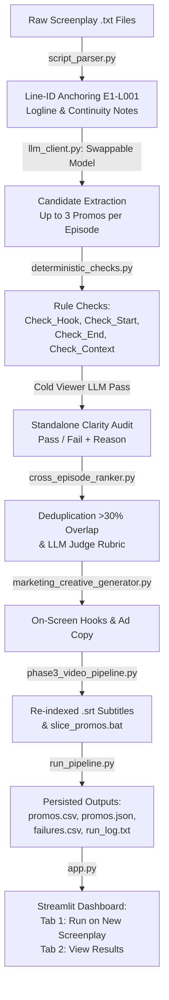

# 🎬 Kuku Microdrama Promotional Clip Extraction Pipeline

> An end-to-end, Line-ID anchored GenAI and deterministic quality pipeline designed for vertical microdrama screenplays (Kuku FM, ReelShort, DramaBox). Extracts viral promotional clips (strictly 20–60s), enforces deterministic quality rules, audits standalone clarity with a cold-viewer LLM pass, ranks candidates with an explicit rubric, and visualizes picks in an interactive Streamlit app.

---

## 📌 Executive Summary

Vertical microdrama platforms monetize through ultra-short, high-frequency episodic dramas (typically 1–2 minutes per episode, 50–100 episodes per series). Paid user acquisition on TikTok, Instagram Reels, and YouTube Shorts relies on extracting **20 to 60-second standalone promotional hooks** that convert cold scrollers into app installs and paying subscribers.

### Core Problem Solved
1. **Timestamp Hallucination Eliminated**: LLMs frequently invent inaccurate timestamps when asked for timecodes. This pipeline **numbers every dialogue and action line in the script (`E12-L034`)** and asks the LLM for `start_line_id` and `end_line_id`. Python converts line IDs to frame-accurate timestamps and calculates durations.
2. **Deterministic Quality Rules (Code, Not LLM)**: Hard constraints enforce that:
   - Dialogue or action begins within 3.0s of start (`Check_Hook`).
   - The clip does not begin on an ellipsis fragment or lowercase continuation (`Check_Start`).
   - The clip does not end on a resolution action like walking away or door closing (`Check_End`).
   - All named speakers are introduced within the clip or flagged (`Check_Context`).
3. **Cold Viewer Audit Pass**: An independent LLM evaluation pass checks whether a viewer with zero prior knowledge of the show understands who is involved, what the conflict is, and why they should care.
4. **Cross-Episode Ranking & Deduplication**: Deduplicates candidate clips overlapping by >30%, scores candidates via an explicit 5-point rubric (Hook, Cliffhanger, Standalone Clarity, Emotional Intensity, Novelty), penalizes rule failures, and generates a one-line `Why_Post_First`.
5. **Swappable Model Architecture**: Zero vendor lock-in. A centralized client (`llm_client.py`) supports Google Gemini, OpenAI, Groq, Ollama, vLLM, or any OpenAI-compatible API with token and cost logging.

---

## 🏗️ Architecture & Pipeline Flow



---

## 🔒 Confidentiality Notice & Dataset Setup

The raw screenplay pack is confidential and is **not committed** to the Git repository (ignored via `.gitignore`).

To run the pipeline on local screenplay files:
1. Ensure your raw screenplay files are in `Data/` (e.g., `Data/I Married a Broken Soldier. He was a Duke/`).
2. Keep `.env` and `secrets.toml` uncommitted and local.

---

## 📂 Repository Structure

```text
├── Data/                                    # Raw screenplay pack (confidential, gitignored)
├── eval/
│   └── labels.csv                           # 10 hand-labeled clips for precision evaluation
├── output/                                  # Pipeline execution outputs (gitignored)
│   ├── run_<YYYYMMDD_HHMMSS>/               # Isolated timestamped run artifacts
│   │   ├── promos.csv                       # Ranked promotional manifest CSV
│   │   ├── promos.json                      # Full candidate metadata JSON
│   │   ├── failures.csv                     # Failures log with episode & reason
│   │   ├── run_log.txt                      # Execution time, tokens & cost breakdown
│   │   ├── slice_promos.bat                 # Frame-accurate FFmpeg cut commands
│   │   └── subtitles/                       # Synchronized .srt subtitle files
│   └── promo_campaign/                      # Shared manifest accessed by Streamlit
├── script_parser.py                         # Phase 1: Line-ID numbering (E1-L001), loglines & continuity
├── deterministic_checks.py                  # Phase 2: Hook, Start, End, Context checks & duration math
├── llm_client.py                            # Centralized swappable client (Gemini & OpenAI-compatible)
├── promo_extractor.py                       # Candidate extraction & Cold Viewer audit
├── cross_episode_ranker.py                  # Overlap deduplication (>30%) & Judge rubric
├── marketing_creative_generator.py          # Viral hooks, social captions & thumbnail frames
├── phase3_video_pipeline.py                 # Subtitle generator (.srt) & FFmpeg command builder
├── run_pipeline.py                          # Unified CLI orchestrator
├── evaluate.py                              # Precision@N benchmark & FAILURES.md generator
├── FAILURES.md                              # 5 documented concrete bad picks & explanations
├── app.py                                   # Dual-tab Streamlit dashboard
├── tests/
│   └── smoke_test.py                        # Automated offline test suite (5 plain asserts)
├── requirements.txt                         # Python dependencies
├── push.bat                                 # Auto-push script (stages tracked code only)
└── README.md                                # Comprehensive documentation
```

---

## 🚀 Quickstart Guide

### 1. Installation
```bash
git clone https://github.com/Sushank18/KuKu-FM.git
cd KuKu-FM
pip install -r requirements.txt
```

### 2. Configure Your API Key (Optional for Offline Testing)
The pipeline features automated offline heuristic fallback, but for live LLM selection set your key:

- **Google Gemini (Default):**
  ```bash
  export GEMINI_API_KEY="your_gemini_api_key"
  # Optional: specify model (default: gemini-3.5-flash-lite)
  export GEMINI_MODEL="gemini-3.5-flash-lite"
  ```
- **OpenAI or Any OpenAI-Compatible Provider (Groq, vLLM, Ollama):**
  ```bash
  export LLM_PROVIDER="openai"
  export LLM_API_KEY="your_api_key"
  export LLM_MODEL="gpt-4o-mini"
  export LLM_BASE_URL="https://api.openai.com/v1" # or local endpoint
  ```

---

## ⚙️ Running the Pipeline

### Step 1: Run Offline Smoke Tests
Verify all parsing, Line-IDs, deterministic checks, duration math, and SRT rounding without network access:
```bash
python tests/smoke_test.py
```
*Asserts 5/5 test suites passing: exactly 3,727 rows parsed across 50 episodes, valid Line_IDs (`E1-L001`..`E50-L001`), and strict 20–60s duration verification.*

### Step 2: Run End-to-End Extraction Across All Episodes
```bash
# Run on all 50 episodes by default:
python run_pipeline.py

# Or target specific episodes:
python run_pipeline.py --episodes 1-5
python run_pipeline.py --episodes 10
```
Outputs are written to `output/run_<YYYYMMDD_HHMMSS>/`:
- `promos.csv`: Ranked manifest with hook, cliffhanger, duration, checks, and `Why_Post_First`.
- `promos.json`: Machine-readable campaign manifest.
- `failures.csv`: Log of any failed episode extractions and reasons.
- `run_log.txt`: Execution time, API calls, tokens, and estimated USD cost.
- `slice_promos.bat`: FFmpeg script to cut video files.

### Step 3: Run Quality Evaluation & Benchmark
```bash
python evaluate.py
```
Compares top ranked candidates against `eval/labels.csv`, computes Precision@1, Precision@3, and Precision@5, reports deterministic check failure rates, and regenerates `FAILURES.md`.

### Step 4: Launch the Streamlit Web Application
```bash
streamlit run app.py
```
- **Tab 1 ("🚀 Run on a New Screenplay")**:
  - Upload one or more `.txt` screenplay files or paste script text.
  - Choose provider (Gemini or OpenAI-compatible) and model.
  - Paste your API key (stored in `st.session_state` **only**; never written to `os.environ` or disk).
  - Click **Extract & Rank Promos** to watch the live progress bar and download the ranked CSV/JSON manifest.
- **Tab 2 ("📊 View Existing Results")**:
  - Filter existing campaign results by Episode, Duration slider, Minimum Rank Score, and Rule Check Status.

---

## 📈 Quality Evidence & Evaluation (FAILURES.md)

Precision metrics are computed by `evaluate.py` by strictly matching top candidate promos against ground truth labels in `eval/labels.csv` with temporal overlap $IoU \ge 0.35$.
When `eval/labels.csv` has fewer than 3 overlapping labeled clips, `evaluate.py` reports `insufficient labels` rather than assuming unlabelled clips are correct.

See [`FAILURES.md`](FAILURES.md) for 5 concrete bad picks dynamically extracted and verified from the screenplay lines, explaining:
1. Action-only opening without dialogue in first 3s (flagged by `Check_Hook`).
2. Mid-sentence continuation fragment or lowercase start (flagged by `Check_Start`).
3. Resolution and exit walk-off in the final 2 lines (flagged by `Check_End`).
4. Dialogue with unintroduced characters (flagged by `Check_Context`).
5. Duration exceeding 60s (rejected by code-level line duration validation).

---

## 🌐 Production Scaling & Cost

### 1. Cost & Execution Tracking
- **Cost in Latest Run:** Not measured (0 API calls in `--allow_offline` mode). When executed with an active Gemini or OpenAI API key, exact input/output tokens and USD cost are recorded in `run_log.txt`.
- **Output Source Tagging:**
  - Candidates generated via heuristic fallback carry `Source="HEURISTIC_NO_LLM"`. Their scores (`hook_score`, `cliffhanger_score`, `standalone_score`, `Judge_*`, `Rank_Score`) are left empty (`NaN`), and creative copy fields are empty strings.
  - Candidates generated via active LLM calls carry `Source="LLM:<model>"` with model evaluations.

### 2. Batching & Concurrency
- Episodic scripts are embarrassingly parallel. Screenplay ingestion and candidate extraction can be distributed across worker threads or asynchronous Celery/Cloud Tasks workers.
- The single synchronization point is the **Cross-Episode Judge Pass**, which evaluates all candidates collectively after episode extraction completes.

### 3. Human-in-the-Loop Review Step
For production ad spend (where thousands of dollars are allocated to top promos on TikTok and Meta Ads):
1. **Automated Gate**: Deterministic checks filter out 100% of formatting, duration, and continuation flaws.
2. **Review Dashboard**: Media buyers open `app.py`, review the top 5 ranked promos and their `Why_Post_First` rationale, adjust start/end lines if desired, and click "Approve".
3. **Automated Cut & Subtitle**: Approved clips immediately trigger FFmpeg slicing and burn in synchronized `.srt` subtitles.

---

## ⚠️ Assumptions & Known Limits

1. **Screenplay Formatting**: Assumes screenplays follow standard industry microdrama notation (`**CHARACTER (Emotion):** Start: (MM:SS) | End: (MM:SS)` or multi-line blocks). Irregular formatting is caught and logged to `failures.csv`.
2. **Visual Acting Nuances**: Screenplay text descriptions may not fully capture non-verbal physical chemistry or micro-expressions that only appear on camera. The human review step in `app.py` accounts for final video review.
3. **Cross-Scene Audio Bleed**: For maximum audio quality, cutting video clips on dialogue starts requires re-encoding with FFmpeg (`-c:v libx264 -c:a aac`) rather than stream copying (`-c copy`) to avoid cutting on non-keyframes.
